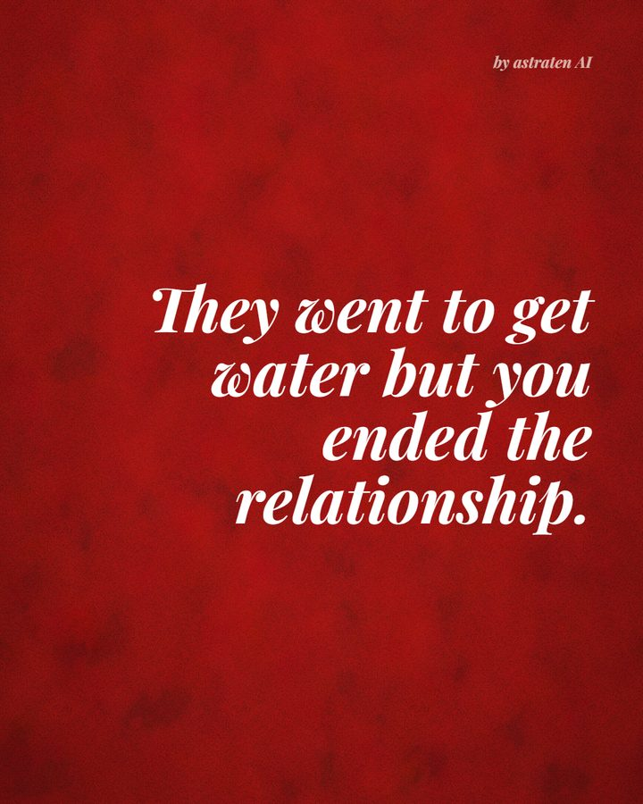
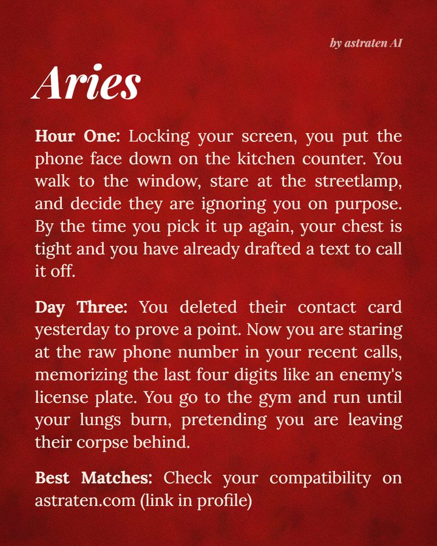
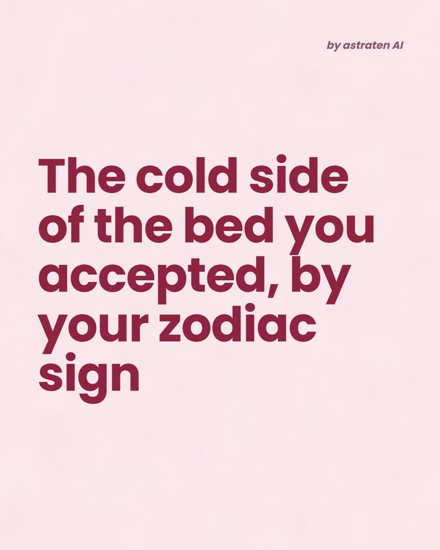
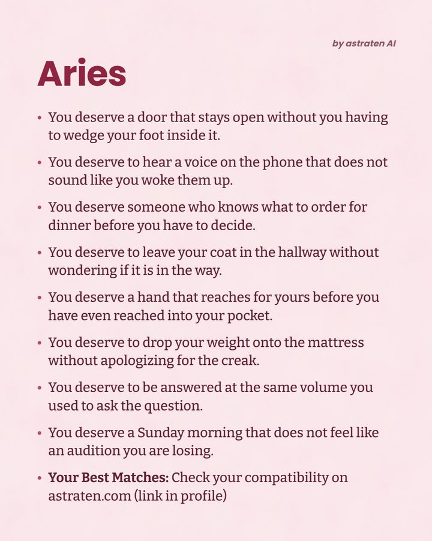
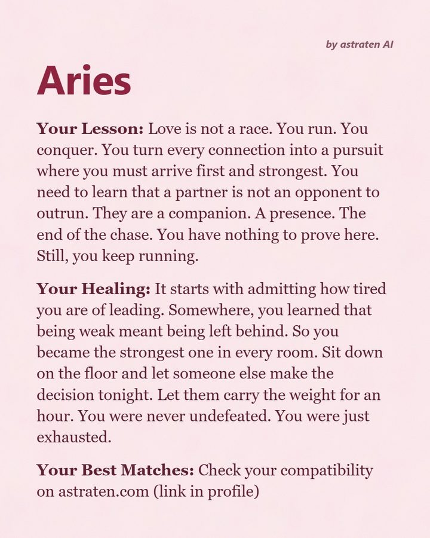
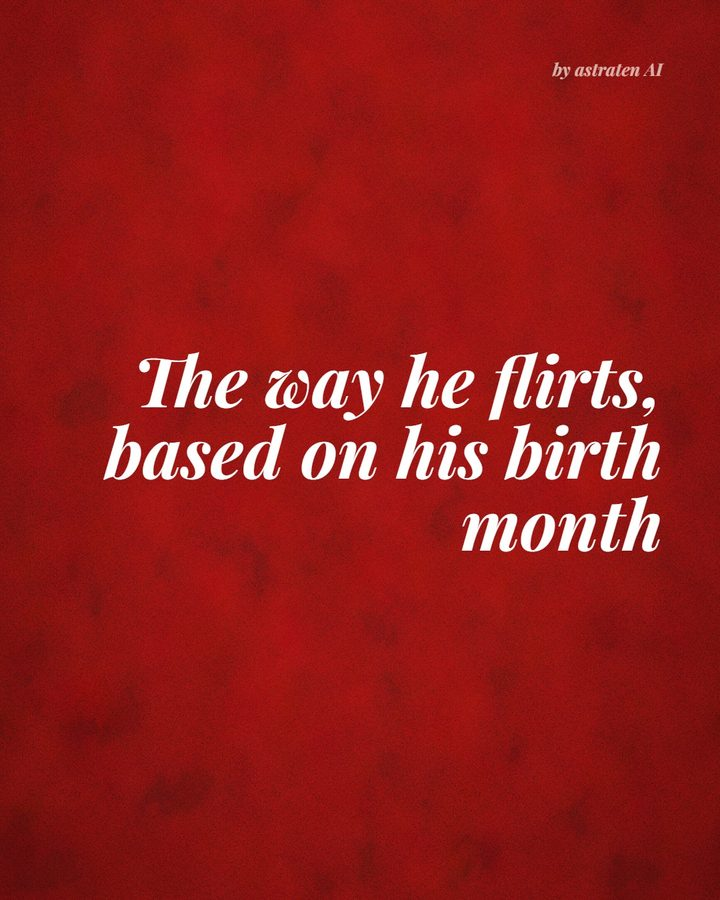
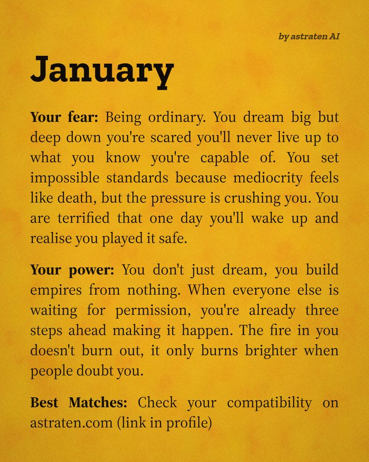
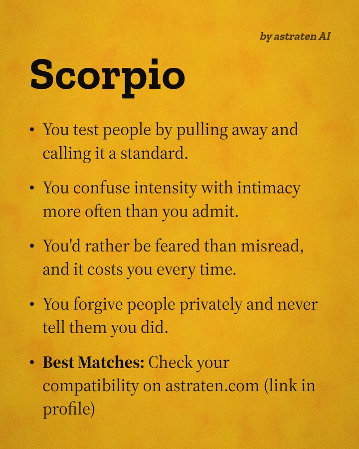
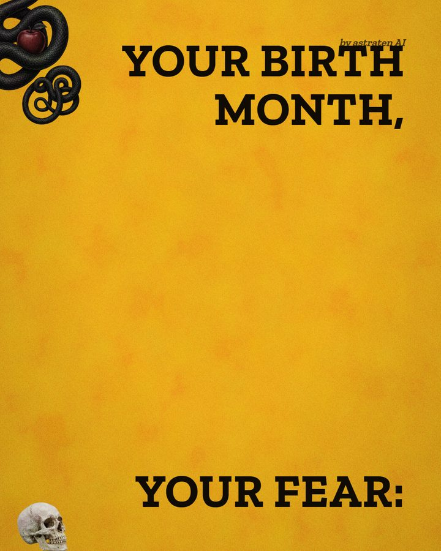
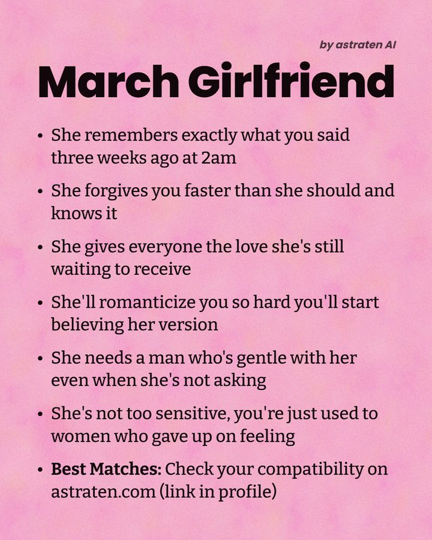

# TemplateAuto — AI Instagram carousel generator

An end-to-end pipeline that writes and renders social-media carousels on its own:
a **seed bank** rolls the brief, a **Gemini prompt chain** writes the copy,
**deterministic QA** checks it in code, and a **headless-Chromium renderer**
turns HTML/CSS templates into 1080×1350 PNG slides. No design tool, no per-image
fee: rendering is CPU time on a box you already run.

It was built to run the Instagram and TikTok content for an astrology brand
(see the [Astraten AI showcase](https://github.com/guja-tsitaishvili/astraten_AIAPP_showcase)),
where posts of this kind reached 50K–250K views.

## Examples

Real output, downscaled. Same engine, five themes, three slide layouts (cover,
prose, bullets).

| | | | | |
|---|---|---|---|---|
|  |  |  |  |  |
| Cover, crimson | Prose slide, crimson | Cover, pink | Bullets, pink | Prose, blush |
|  |  |  |  |  |
| Split-title cover | Prose, mustard | Bullets, mustard | Cover with cut-out artwork | Bullets, alternate voice |

## How it works

```
seed bank → prompt chain (Gemini) → QA in code → compose → render → PNG slides
```

1. **Seed.** Before any AI writes a word, a brief is rolled from angle × voice × subject × format. The model never chooses *what* to write about, only how. See [seeds/README.md](seeds/README.md).
2. **Prompt chain** ([src/generate.js](src/generate.js)). Hooks (about 20, high temperature, forced structural variety) → a judge scores them against a rubric and picks the winner → every slide body is written to that hook → caption and hashtags. Each step is its own call, so a failure retries in isolation. All calls are schema-constrained JSON.
3. **Deterministic QA** ([src/quality.js](src/quality.js)). Length limits, banned phrases and a repeated-opening check run in plain code. They are free, instant and cannot be talked out of a verdict. A failed body step is retried.
4. **Anti-repetition memory.** Idea memory forbids a thought used recently, imagery memory stops the model reaching for the same trope again (Aries always becomes fire and battle), and facet picking hands the model a specific trait *before* writing, so it does not free-associate into the default.
5. **Compose and render** ([src/compose.js](src/compose.js), [src/renderer.js](src/renderer.js)). Themes are JSON files. Text is fitted by binary-searching a scale factor so copy of any length fills the slide.
6. **Service mode** ([src/server.js](src/server.js)). An Express API (`/render`, `/carousel`, `/themes`) designed to be called from an n8n workflow that posts the finished slides.

Other engineering details:

- **Cost visibility.** Every Gemini call appends model and token counts to a usage log.
- **Retries.** The adapter absorbs transient 429/503 overloads so a scheduled post does not fail on a blip.
- **Optional local model.** An Ollama adapter can take the cheap steps. It is off by default because it was measured and lost: about 12% token saving, and on an identical hook list it picked a 5/10 hook over an 8.5/10 one. See [TODO.md](TODO.md).
- **Batch mode** ([src/batch.js](src/batch.js)) fills a review buffer ahead of time, so a bad batch or a provider outage never reaches the feed.

## Artwork is not included

The renderer can place background-removed PNG cut-outs on cover slides (see
[Decorations](#decorations-hook-artwork)). The `designpics/` image library is
deliberately **not** in this repository: it is large and may include third-party
material. Art-free designs such as the `blush` theme render without it, and
`09-cover-with-artwork.jpg` above shows what an art cover looks like. To use your
own, drop background-removed PNGs into `designpics/`. The catalog and generation
notes are kept in that folder.

You need a `GEMINI_API_KEY` in `.env` (see [.env.example](.env.example)) to generate copy.
Rendering from JSON does not need one.

## Setup

```bash
npm install
npx playwright install chromium
```

## Generate from a JSON file

```bash
node src/cli.js samples/demo.json out
```

Writes `out/demo-01.png` … one PNG per slide at 1080×1350 (Instagram 4:5).
Set `width` / `height` in the JSON for a different ratio (e.g. `1080`/`1080`).

## Run as a service (what n8n calls)

```bash
node src/server.js
```

| Route | Method | Body | Returns |
| --- | --- | --- | --- |
| `/health` | GET | — | `{ ok: true }` |
| `/themes?mood=love` | GET | — | `{ moods, themes: [{name,label,moods,allowArt,bg,ink}] }` |
| `/render` | POST | one slide spec | `image/png` bytes |
| `/carousel` | POST | `{ slides: [...] }` | `{ slides: [{ index, filename, base64 }] }` |

`PORT` defaults to `3001`. Chromium is launched once at boot and reused, so a
slide costs roughly 300–800 ms after warm-up.

In n8n: HTTP Request node → `POST http://localhost:3001/carousel` with the AI
node's output as the body, then convert each `base64` field to binary before the
posting step.

## Slide spec

### Content slide

```json
{
  "type": "content",
  "theme": "yellow",
  "title": "January",
  "sections": [
    { "label": "Your fear:", "text": "Being ordinary. You dream big but..." },
    { "label": "Your power:", "text": "You don't just dream, you build..." }
  ]
}
```

Use `bullets: ["...", "..."]` instead of `sections` for the bullet-list look.
`**bold**` works inside any body string.

The promo line is appended automatically — don't write it into `sections` or
`bullets` yourself or it will appear twice.

### The promo line (CTA)

Every content slide closes with it, so the space it takes is a permanent part of
the layout rather than something that shows up on some slides and not others.
Wording lives in [cta.json](cta.json):

```json
{
  "default": 0,
  "variants": [
    { "label": "Best Matches:", "text": "Check your compatibility on astraten.com (link in profile)" }
  ]
}
```

Edit `variants` to change or add wording; `default` picks which one is used when
a slide doesn't say. Per slide:

| `cta` value | Result |
| --- | --- |
| *omitted* | the `default` variant |
| `2` | `variants[2]` — how to rotate different fixed texts |
| `"Any string"` | used verbatim, no bold label |
| `{ "label": "…", "text": "…" }` | used as-is |
| `false` | no promo line on this slide |

It renders as a final section on prose slides and a final bullet on bullet
slides, matching whichever layout it lands in.

### The signature

`by astraten AI` is drawn in the top-right corner of **every** slide, cover and
content alike. On content slides it sits above the title; on covers it's pinned
to the corner so it doesn't push the centred text down.

Override the wording per slide with `signature`, or change the house default at
the top of [src/template.js](src/template.js).

### Cover slide

```json
{ "type": "cover", "theme": "sage", "title": "What each zodiac sign secretly needs to hear" }
```

Split cover — one line at the top, one at the bottom, artwork between:

```json
{
  "type": "cover",
  "theme": "crimson",
  "titleTop": "Your birth month,",
  "titleBottom": "your toxic attraction"
}
```

### Decorations (hook artwork)

Cut-out PNGs from `designpics/`, bled off the edge so they read as a crop rather
than a pasted sticker. Put them on the **hook slide only** — content slides stay
clean.

```json
{
  "type": "cover",
  "theme": "mustard",
  "titleTop": "Your birth month,",
  "titleBottom": "your fear:",
  "decorations": [
    { "src": "skull", "at": "bottom-left", "size": 26, "rotate": -6 },
    { "src": "grapes", "at": "top-right", "size": 30, "flip": true }
  ]
}
```

| Field | Meaning |
| --- | --- |
| `src` | Alias, filename, or loose substring of a file in `designpics/` |
| `at` | `top-left`, `top-right`, `bottom-left`, `bottom-right`, `top-center`, `bottom-center`, `left-center`, `right-center` |
| `size` | Width as a % of poster width (default 30) |
| `bleed` | How far off-canvas to push it, as a % of **its own** size (default 12) |
| `rotate` | Degrees |
| `flip` | Mirror horizontally — reuse one asset on both sides |
| `opacity` | 0–1 |
| `x` / `y` | Explicit % position, overrides `at` on that axis |

Images are inlined as data URIs at render time, so nothing is fetched over the
network while the page is rasterizing.

Current art — `src` is just the filename without the extension:

| `src` | File |
| --- | --- |
| `snake` | `designpics/snake.png` |
| `skull` | `designpics/skull.png` |
| `grapes` | `designpics/grapes.png` |
| `amphora` | `designpics/amphora.png` |

Drop a new PNG in `designpics/` with a plain lowercase name and it's usable
immediately — no registration step. `designpics/aliases.json` only exists for
extra nicknames (`qvevri` → `amphora.png`); it isn't needed for normal use.

Assets must be **background-removed PNGs**. A photo with its background still
attached renders as a visible rectangle sitting on the poster color.

Decorations sit behind the text, but they can still crowd it — keep them out of
the corner the title occupies (each theme's `coverAlign` decides that corner).

### Per-slide overrides

`theme`, `titleSize`, `bodySize`, `subtitleSize`, `titleWidth`, `titleTransform`,
`maxFit`, `cta`, `signature`, `decorations`, `background`, `backgroundPosition`.

`background` fills the whole canvas (accepts a designpics name, a URL, or a
`data:` URI); `decorations` place cut-outs on top of the poster color.

## Content seeds

Before any AI writes a word, a specific brief is rolled: angle x voice x subject
x format. 101 angles x 2 active subjects = 550 valid combinations, with mood
constraints so `your addiction` never gets rolled as a love post, and an angle
cooldown so the same idea does not come back for ~60 posts.

```bash
node src/seed.js --mood toxic --count 5
```

Full spec and how to add angles: [seeds/README.md](seeds/README.md).

## Themes

One theme = one JSON file in [themes/](themes/). Drop a file in and it's
registered — no code change. Full spec in
[themes/README.md](themes/README.md), which is written so an AI can add a design
from it unaided.

| Name | Look | Moods | Art |
| --- | --- | --- | --- |
| `yellow` | Yellow / black, slab title, justified prose | negative, toxic | yes |
| `crimson` | Red / white, italic display, grain + vignette | toxic, negative | yes |
| `pink` | Pink / black, heavy geometric title | love, positive, negative | yes |
| `blush` | Light pink / dark pink, clean | love, positive | no |
| `sage` | Sage / olive vintage serif, ornate framed covers | positive, love | yes |

`yellow` also answers to `mustard`.

### Moods

Every theme declares which subject matter it suits, from the fixed set
**`love`**, **`positive`**, **`negative`**, **`toxic`**. That lets the pipeline
send a subject and let the registry pick the palette:

```bash
curl "http://localhost:3001/themes?mood=toxic"
```

```json
{ "mood": "love", "seed": 3, "slides": [ ... ] }
```

`seed` walks the matching themes, so consecutive posts on the same subject don't
all land on the same colour. A slide's own `theme` always wins over `mood`.

### Light themes stay clean

`blush` sets `allowArt: false`, so decorations are silently declined on it. The
same slide spec can be re-themed between a dark art-carrying design and a light
clean one without editing the slide.

Fonts load from Google Fonts at render time and are awaited before the
screenshot. All copy is English — if a non-Latin script is ever added, each
theme's stack needs a font that actually covers it, or Chromium silently
substitutes whatever the host machine happens to have.

## Text fitting

Copy length varies per generation, so every type size is `calc(<px> * var(--fit))`
and [src/renderer.js](src/renderer.js) binary-searches `--fit` for the **largest**
value that still fits the frame.

Scaling **up** matters as much as scaling down. A four-bullet slide left at 1.0
renders with the bottom half of the poster empty, which is the clearest tell that
a layout was generated rather than designed. Growing the type to meet the frame is
what makes a short slide and a long one look like the same series.

Range is 0.45 to 1.35 on content slides. Covers cap at 1.0 — their display sizes
are already tuned large and their box is the whole poster, so letting a short hook
grow would fill every pixel. Override per slide with `maxFit`.

## Layout

- [seeds/](seeds/) — angle/voice/subject bank + [how to add angles](seeds/README.md)
- [src/seed.js](src/seed.js) — the seed roller
- [themes/](themes/) — one JSON per design + [how to add one](themes/README.md)
- [src/themes.js](src/themes.js) — theme registry, mood lookup
- [src/template.js](src/template.js) — slide spec → HTML document
- [src/assets.js](src/assets.js) — designpics lookup + data-URI inlining
- [src/renderer.js](src/renderer.js) — Chromium, font wait, fit pass, screenshot
- [src/server.js](src/server.js) — HTTP API
- [src/cli.js](src/cli.js) — batch render a JSON file
- [samples/demo.json](samples/demo.json) — one slide per theme
- [samples/variations.json](samples/variations.json) — 10-poster spread across all themes and layouts
- [samples/core4.json](samples/core4.json) — the 4 core themes, prose and bullets each
- [samples/crimson-prose.json](samples/crimson-prose.json) — crimson prose reference slide
- [src/cta.js](src/cta.js) + [cta.json](cta.json) — the promo line
- `designpics/` — decoration art, `aliases.json`, and [PROMPTS.md](designpics/PROMPTS.md) for generating new art
